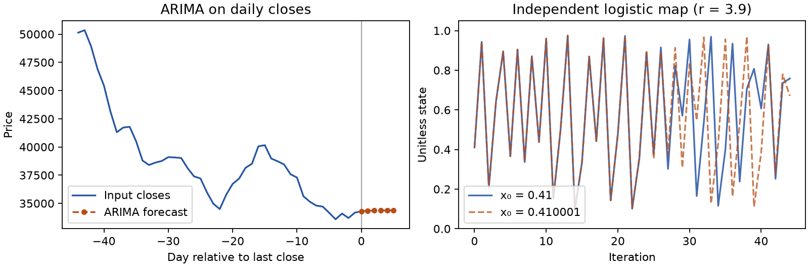

# Chaos Theory & Crypto Dynamics

A Python experiment that fits **ARIMA to daily crypto closes** and illustrates
sensitive dependence on initial conditions with a **separate logistic map**.
Try the offline example first, then use your own CSV or download historical
`BTC-USD` bars. The logistic map does not enter the price forecast.



## Quick start

Use **Python 3.12**. Installing dependencies requires internet access; the
synthetic example and tests run locally afterward.

```sh
git clone https://github.com/0xmrpinheiro/chaos-theory-crypto-dynamics.git
cd chaos-theory-crypto-dynamics
```

**macOS / Linux**

```sh
python3.12 -m venv .venv
.venv/bin/python -m pip install -r requirements.txt
.venv/bin/python crypto_prediction.py --sample --holdout 20 --plot crypto-demo.png
```

**Windows PowerShell**

```powershell
py -3.12 -m venv .venv
.\.venv\Scripts\python.exe -m pip install -r requirements.txt
.\.venv\Scripts\python.exe crypto_prediction.py --sample --holdout 20 --plot crypto-demo.png
```

Open `crypto-demo.png` to see the two experiments side by side. Both the input
prices and the logistic-map values in the offline example are synthetic.

## Run on historical daily bars

With the virtual environment active:

```sh
python crypto_prediction.py --ticker BTC-USD --start 2020-01-01 --end 2025-01-01 --holdout 20
python crypto_prediction.py --csv prices.csv --holdout 20
```

The ticker command downloads **historical daily OHLC**, not a real-time stream.
The end date is exclusive; the default excludes the current UTC day. For a
repeatable input, use a fixed CSV with `Date`, `Open`, `High`, `Low`, and `Close`
columns. Use ISO dates and one bar per consecutive UTC day, including weekends.
The script checks for duplicates, missing days, and invalid prices.

## What the outputs mean

| Output | How to read it |
| --- | --- |
| Recent ATR | A simple average of the latest 14 true ranges by default. It includes both gaps from the previous close, and the first bar uses only high minus low. The output also shows ATR as a percentage of the final close. |
| ARIMA forecast | ARIMA(1,1,1) fits closing prices only, scaled by the final available close and converted back to price units. The forecast starts after the last input bar. A flat series returns a flat forecast. |
| Logistic map | Two unitless trajectories with nearby starting points. The sequence neither predicts prices nor demonstrates that Bitcoin prices are chaotic. |
| Optional holdout | Fit on the prefix, then forecast the entire holdout from that single origin. Compare MAE and RMSE against predicting the last training close at every step. The separate forward forecast uses all supplied closes. |

This is an educational experiment, not a trading system. A single holdout is
not evidence of repeatable forecasting skill; synthetic scores are only a check
of the workflow. The script does not issue trading instructions.

## Tests

```sh
python -m unittest discover -s tests -v
```

The companion [equity chaos experiment](https://github.com/0xmrpinheiro/chaos-theory-equity-dynamics)
uses the same comparison on equity data. For a separate example of event
streaming rather than historical forecasting, see the [Crypto WebSocket Ingestion Pipeline](https://github.com/0xmrpinheiro/crypto-websocket-ingestion-pipeline).

Licensed under [GPL-3.0](LICENSE).